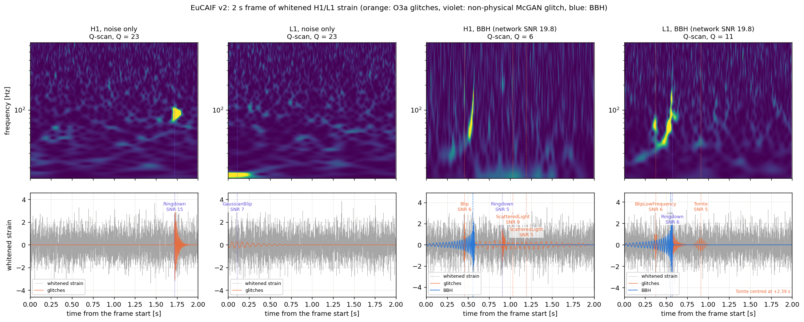

# EuCAIF dataset v2: noise, BBH signals and glitches, on the fly

Whitened H1/L1 strain that mixes stationary Gaussian noise, binary-black-hole signals (exactly v1's
prior, waveform model, projection and whitening; see `README_dataset.md`) and **analytic glitches
with O3a rates**, for training on the fly. The network can take the **time series**, a **Q-scan**
(gwpy-exact) or SAGE's **invertible Q-transform tiles** as input. Everything is set in one file,
`eucaif/eucaif_v2.yaml`.

Run from the SAGE repo root with `PYTHONPATH=.`, in an environment with PyCBC (analytic ASDs) and
h5py, as for v1.

## What changes from v1

| | v1 | v2 |
|---|---|---|
| Content | noise, or noise + BBH (50 / 50) | the same, plus glitches in both classes |
| Glitches | none | Blip, Tomte, Blip_Low_Frequency, Scattered_Light (analytic), O3a class mix; plus one non-physical (McGAN) glitch per frame and detector |
| Stored window | 2 s | 4 s: 1 s + **2 s frame** + 1 s, so Q-transforms can be cut to the frame |
| `tc` | from the window start, in [0.5, 1.5] s | from the stored window start, in [1.5, 2.5] s (the same place in the frame) |
| Targets | label, BBH parameters, SNR | also the whitened glitches and the whitened BBH alone, per detector |
| Use | fixed HDF5 file | on the fly for training; fixed HDF5 files for validation / test |

With `glitches.probability: 0` and `nonphysical_glitches.probability: 0` the examples are v1's
(the generator reproduces v1 bit for bit with glitches off).



A noise-only and a BBH example (network SNR 19.8), H1 and L1: Q-scans of the 2 s frame (top) and the
whitened time series (bottom). Orange: O3a glitches, violet: the non-physical McGAN glitch, blue:
the BBH (dashed: merger time); each glitch is labelled with its class and SNR. Note that the Q-scan
picks its Q per detector (gwpy's behaviour), so H1 and L1 can differ. Made, with timings, by
`python3 eucaif/example_eucaif_v2.py --timing` (~3.4 ms per example in batches on one CPU core).

## The config (`eucaif/eucaif_v2.yaml`)

- `data`: detectors and ASDs, sample rate (2048 Hz), frame length (2 s), `q_padding` (1 s on each
  side, for the Q-transform; the transform is circular, so the padding absorbs its wrap-around),
  `signal_padding` (4 s generated on each side for the BBH inspiral and the whitening), whitening.
- `signal`: v1's prior (`sage_eucaif_waveform.yaml`), with `tc` moved into the frame
  (`tc_in_frame`), and optional SNR rescaling (`snr_range`; `null` keeps v1's physical distances,
  network SNR median ~9).
- `glitches`: the population file (`sage_analytic_glitches.yaml`), the fraction of
  (example, detector) pairs with glitches (`probability`, 0.5), how many when present
  (`per_window`, 1-3), and their low-frequency cut. Glitches are independent in H1 and L1
  (no coherence), BBH signals are coherent.
- `nonphysical_glitches`: McGAN's training shapes (ringdown, white-noise burst, Gaussian blip),
  which are **not real glitch classes** and are added on purpose, as extra varied transients:
  exactly one per (example, detector) (`per_window: [1, 1]`, `probability: 1.0`), the class drawn
  uniformly, with the **Blip's SNR distribution** (5-200, index 2.3; `snr_like: Blip`), drawn
  independently of the O3a glitches. In the glitch table and `glitch_classes` they come after the
  O3a classes.
- `qtransform`: Q-scan grid (Q 4-64, 15-1000 Hz, 256 x 256 over the frame) and the Q-planes for
  invertible tiles (5.7 and 45.3).

## Where the glitch rates come from

`sage_analytic_glitches.yaml` follows **GWForge** (Koustav Chandra et al.,
https://github.com/koustavchandra/gwforge, MIT): its configuration format, its Blip and Tomte
classes and ranges, and its way of setting rates. GWForge motivates its numbers on the public
Gravity Spy O3a tables; we took that recipe and applied it to all our classes:

- Gravity Spy O3a classifications ([Zenodo 5649212](https://zenodo.org/records/5649212),
  doi:10.5281/zenodo.5649212, CC BY 4.0; Glanzer et al. 2023, Class. Quantum Grav. 40 065004,
  [doi:10.1088/1361-6382/acb633](https://doi.org/10.1088/1361-6382/acb633)) with `ml_confidence >= 0.9`;
- rate = count / GWOSC O3a observing time (DATA segments: 3116 h at H1, 3321 h at L1);
- frequency ranges from the 5-95 % quantiles of Omicron's peak frequency, and the SNR power-law
  index from a maximum-likelihood fit to Omicron SNRs above 7.5 (used, as in GWForge, for the
  optimal SNR on 5-200).

`python3 eucaif/gravityspy_o3a_rates.py --data-dir gravityspy_o3a` downloads the tables (~230 MB)
and recomputes everything; it reproduces GWForge's published Blip and Tomte numbers.

| Class (model) | H1 / hour | L1 / hour | Peak frequency | SNR index |
|---|---|---|---|---|
| Blip (sine-Gaussian, GWForge) | 1.30 | 0.66 | 93-630 Hz | 2.3 |
| Tomte (sine-Gaussian, GWForge) | 0.22 | 6.28 | 32-61 Hz | 2.2-2.4 |
| Blip_Low_Frequency (sine-Gaussian, Blip's Q) | 0.45 | 2.50 | 38-125 Hz | 4.8 |
| Scattered_Light (ArchEnemy arch) | 3.03 | 1.90 | 18-38 Hz | 2.4 |

In the dense mode used here (`per_window`), these rates set the **class mix per detector**: L1 gets
mostly Tomtes, H1 mostly scattered light. Not modelled (no analytic shape): Fast_Scattering
(7.6 / h at L1), Low_Frequency_Burst (5.8 / h at H1), Koi_Fish, Whistle, Extremely_Loud.

## Training on the fly

```python
import torch
from torch.utils.data import DataLoader
from eucaif.eucaif_v2 import EucaifV2OnTheFly, QTransforms

train = EucaifV2OnTheFly("eucaif/eucaif_v2.yaml", batch_size=64, batches_per_epoch=1000, seed=0)
loader = DataLoader(train, batch_size=None, num_workers=8)       # items are whole, shuffled batches
qt = QTransforms("eucaif/eucaif_v2.yaml", device="cuda")

for epoch in range(n_epochs):
    train.set_epoch(epoch)                                        # fresh examples every epoch
    for batch in loader:
        x = batch["x"].cuda()                                     # (B, 2, 8192): H1, L1 stored window
        y = batch["y"].cuda()                                     # 1: BBH present
        # pick one input representation:
        inp = qt.frame(x)                                         # (B, 2, 4096) time series, the frame
        inp = qt.qscan(x)                                         # (B, 2, 256, 256) Q-scan of the frame
        tiles = qt.tiles(x)                                       # {5.7: (B, 2, 22, 8192), 45.3: (B, 2, 183, 1024)}
        ...
```

- Each item also has `glitch` and `signal` (whitened, per detector: denoising / glitch-removal
  targets), `n_glitches` (B, 2), `snr` and `tc` (NaN for noise-only examples).
- Batch *i* of epoch *e* is fully determined by `(seed, e, i)` (noise, glitches, BBH parameters and
  projection), whatever the number of workers.
- Speed: ~380 examples/s per CPU process for generation; compute the Q-transforms on the GPU.
- `qt.qscan` is gwpy's Q-scan (one Q per example and detector, median-normalised), computed on the
  stored window and output on the frame only. `qt.tiles` are invertible: `qt.inverse(tiles[q], q)`
  returns the time series (then `qt.frame`), so a network can work in the Q domain and be trained
  with a time-domain loss.

## Fixed validation and test sets

Generate them once, from a clean checkout of the tagged release, with different seeds:

```bash
python3 eucaif/eucaif_v2.py eucaif/eucaif_v2.yaml --fig v2_check.png                # checks + figure only
python3 eucaif/eucaif_v2.py eucaif/eucaif_v2.yaml --n-per-class 5000 --seed 1 --out eucaif_v2_val.h5
python3 eucaif/eucaif_v2.py eucaif/eucaif_v2.yaml --n-per-class 5000 --seed 2 --out eucaif_v2_test.h5
```

The checks print the whitened-noise standard deviation (~1), the BBH SNR median, the fraction of
(example, detector) pairs with glitches and the classes drawn; the figure shows a noise-only, a
noise + glitch, a BBH and a BBH + glitch example as Q-scans and time series. Use seeds for the
training run that differ from the stored sets.

File layout: v1's (`x`, `t`, `metadata/*`; see `README_dataset.md`) with `x` of shape (N, 2, 8192)
and `tc` from the stored-window start, plus:

```
glitch              (N, 2, 8192)  whitened glitches alone (zeros where none)
n_glitches          (N, 2)        glitches per example and detector
glitches/example    one row per glitch: example index, detector index, class index (attrs glitch_classes),
glitches/...        time (s from the stored-window start), snr, and the generator parameters
attrs               v1's, plus eucaif_v2_config (the full YAML), frame_slice, glitch_population,
                    dataset_version = "eucaif v2"
```

About 0.13 MB per example in float32 (strain and glitches): 10,000 examples are ~1.3 GB.

## Reproducibility and version

Data are determined by the code version, the config, the seed and the command, all stored in the
file. Cite the tagged release **`eucaif-dataset-v2.0`** of https://github.com/MelissaLP/sage and
generate published files from a clean checkout of it, so `sage_version` in the file is the tag.

## Caveats

- Idealised noise (one analytic PSD, stationary, Gaussian) and idealised whitening (exact ASD), as v1.
- Glitches are analytic shapes with realistic rates and frequency ranges, not real glitches; several
  frequent O3a classes are missing (see above).
- Gravity Spy SNRs are Omicron SNRs above 7.5; the SNR indices are applied to the optimal SNR on
  5-200, as GWForge does.
- Glitches sit anywhere in the stored window, so some are partly or fully outside the 2 s frame.
