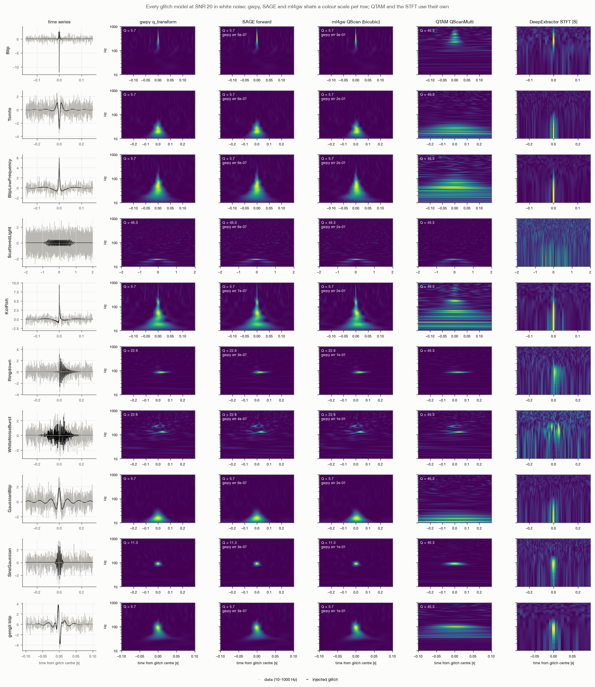

# Q-transform benchmark: SAGE, ml4gw, QTAM, gwpy and DeepExtractor's STFT

`eucaif/benchmark_qtransform.py` times the time-frequency transforms we use or compare against,
on batches of whitened strain. The libraries do different amounts of work by default, so the
script compares them **one task at a time** (`--task`): every library does the same job with
the same settings (duration, sample rate, `qrange`, `frange`, mismatch, output grid,
normalisation, float32, batch size, device).

| Library | What it is |
|---|---|
| **SAGE** `sage.dsp.qtransform.QTransform` | gwpy's Q-transform in torch, batched, differentiable: `forward` (gwpy-exact image), `tiles` / `inverse` (invertible complex tiles), `best_q` |
| **ml4gw** `ml4gw.transforms` | `QScan` / `SingleQTransform`: fast Q-scan images, energies only, one Q per batch, not invertible |
| **QTAM** `qtam` | invertible Q-transform with its own frequency rows and windows; no median normalisation |
| **gwpy** | the reference (`q_transform`, `q_scan`, `QPlane`): numpy, CPU only, one series at a time |
| **DeepExtractor's STFT** | `torch.stft` / `torch.istft` (n_fft 512, Hann window 64, hop 32) |

## The five tasks

| `--task` | Job | gwpy | ml4gw | QTAM | SAGE |
|---|---|---|---|---|---|
| `scan` (default) | Q-scan image: every Q-plane, median-normalised energies, the loudest plane, interpolated onto one image | `q_transform` | `QScan` (one Q per batch) | `QScanMulti` (no median) | `forward()` |
| `singleq` | the same image at one fixed Q (`--q`) | `q_transform(qrange=(q, q))` | `SingleQTransform` | `SingleQTransform`, energy | `forward()` with `qrange=(q, q)` |
| `tiles` | raw tiles at one Q: no normalisation, no interpolation | `QPlane.transform` | `compute_qtiles` (energies) | complex tiles, full or `num_time` grid | `tiles()` (complex) |
| `roundtrip` | tiles at one Q and back to the time domain | – | – | complex tiles + `invert_qtransform` | `tiles()` + `inverse()` |
| `bestq` | only the choice of the loudest Q-plane, no image | `q_scan` | all planes + `get_max_energy` | – | `best_q()` |

The STFT appears in `scan` (DeepExtractor's magnitude + phase) and `roundtrip` (STFT + iSTFT);
`--task all` runs the five tasks. Each method also gets a check, computed on the device being
timed. Which error matters depends on the task:

- `scan`, `singleq`: largest difference from gwpy's image, relative to its peak ("gwpy err").
- `tiles`: the same for the raw tile energies, at each row's own times ("gwpy err"). SAGE's
  `|tiles|^2` and ml4gw's `compute_qtiles` are gwpy's tile energies; QTAM's tiles are not.
- `bestq`: fraction of series whose Q matches gwpy's ("Q = gwpy").
- `roundtrip`: relative reconstruction error within [2 f_low, 0.8 f_high] ("recon. err"); gwpy
  has no inverse.

QTAM and the STFT are different transforms, so they have no gwpy check except in `roundtrip`.

## Why the costs differ

- **Row lengths.** In gwpy's tiling each frequency row has its own number of time tiles (few at
  low frequency, many at high frequency). gwpy, ml4gw and SAGE's `forward` compute each row at
  that natural length. SAGE's `tiles` and QTAM put every row on one shared time grid, which a
  network needs and which keeps the transform exactly invertible. That costs 3-7x more FFT
  points for SAGE (padding to the plane's longest row) and up to about 14x for QTAM at full
  resolution (padding to the data length).
- **Median normalisation.** gwpy divides each row by its median and picks the loudest plane from
  those normalised energies. An exact per-row median on every plane is the largest single cost of
  `forward()` and `best_q` (70-75% of `forward()` at 2 kHz). ml4gw does the same with
  `torch.quantile`; QTAM does not normalise.
- **Interpolation.** SAGE's `forward` reproduces gwpy exactly (a cubic spline per row, then
  interpolation onto the output frequencies). ml4gw resizes with bicubic `F.interpolate`, one fast
  kernel, which is why it does not match gwpy (check column about 0.9). QTAM keeps its own rows.
- **One Q per batch.** ml4gw picks the plane with the loudest tile in the whole batch, so most
  series in a mixed batch get a Q other than gwpy's (50-75% agreement here). SAGE picks per series.
- **Loops in Python.** ml4gw and QTAM loop over frequency rows (one small FFT each); SAGE does one
  gather and one batched FFT per plane. On CPU the loop costs little; on GPU each row is a few
  kernel launches.
- **The inverse.** SAGE inverts directly from its grid, reading only the windowed bins (5-11% of
  the grid). QTAM with a reduced `num_time` first upsamples every row back to full resolution.

So `forward()` costing more than `tiles` + `inverse` is expected: it scans every plane with
medians and interpolates, while the round trip touches one plane with neither.

## Results

Apple M5 (virtual machine, 4 CPU cores, 8 GB), torch 2.10, float32, best of 3 runs. Milliseconds
**per series** at the largest batch (256 for 2 s, 64 for 8 s), CPU / MPS (the Mac's GPU). Raw outputs are
reproducible with the commands below.

**2 s at 4096 Hz, 20-1000 Hz, image 257 x 257 (DeepExtractor's setup), Q = 11.31 for the fixed-Q tasks**

| Task | SAGE | ml4gw | QTAM | gwpy (CPU) | STFT | Check (CPU) |
|---|---|---|---|---|---|---|
| `scan` | 3.4 / 1.5 | 2.0 / 2.5 (spline: 4.5 / fails) | 2.2 / 2.1 | 32 | 0.29 / 0.09 | gwpy err: SAGE 1.6e-6, ml4gw 0.93 |
| `singleq` | 1.5 / 0.5 | 0.57 / 0.34 (spline: 11.6 / fails) | 0.29 / 0.13 | 7.6 | – | gwpy err: SAGE 6.0e-7, ml4gw 0.98 |
| `tiles` | 0.69 / 0.09 | 0.15 / 0.15 | 1.7 / 0.49 (full), 0.41 / 0.21 (`num_time`) | 6.0 | – | gwpy err: SAGE 4.3e-7, ml4gw 3.5e-7 |
| `roundtrip` | **1.4 / 0.2** | – | 3.5 / 1.3 (full), 3.5 / 2.3 (`num_time`) | – | 0.65 / 0.35 | recon. err: all 1e-7 to 5e-7 |
| `bestq` | 1.4 / 0.7 | 1.8 / 2.5 | – | 34 | – | Q = gwpy: SAGE 100%, ml4gw 75% |

**8 s at 8192 Hz, 10-2000 Hz, image 257 x 2049, Q = 11.31 for the fixed-Q tasks**

| Task | SAGE | ml4gw | QTAM | gwpy (CPU) | STFT | Check (CPU) |
|---|---|---|---|---|---|---|
| `scan` | 37 / 9.0 | 19 / 14 (spline: killed, out of memory) | 23 / 10 | 80 | 2.3 / 0.7 | gwpy err: SAGE 7.9e-7, ml4gw 0.92 |
| `singleq` | 17 / 3.3 | 5.5 / 2.1 | 3.2 / 1.3 | 34 | – | gwpy err: SAGE 5.7e-7, ml4gw 0.85 |
| `tiles` | 8.7 / 1.2 | 1.5 / 0.9 | 24 / 5.4 (full), 6.7 / 2.2 (`num_time`) | 12 | – | gwpy err: SAGE 4.0e-7, ml4gw 4.0e-7 |
| `roundtrip` | **16 / 2.7** | – | 53 / out of memory (full), 65 / out of memory (`num_time`) | – | 5.1 / 2.3* | recon. err: all 1e-7 to 6e-7 |
| `bestq` | 15 / 4.2 | 18 / 14 | – | 51 | – | Q = gwpy: SAGE 100%, ml4gw 50% |

\* The STFT ran out of memory on MPS after QTAM's failures in the same process (MPS does not
return that memory); 2.3 ms is from a run without QTAM (`--skip QTAM`). On MPS the checks are
about 1e-6 to 5e-6 (float32 on the GPU), with the same Q agreement.

What this shows (the answer depends on the task):

- **Only SAGE and ml4gw's raw tiles reproduce gwpy's numbers**, and only SAGE does so for the
  images and the Q choice (images to about 1e-6, the same Q for every series). SAGE is 1.3-24x
  faster than gwpy's loop on CPU (most for small inputs and for `bestq`).
- **For images, the gwpy-exact spline and medians cost something.** On CPU, ml4gw's bicubic image is
  1.7-3x faster than SAGE's `forward` and QTAM's single-Q image (its own rows, no median) is
  faster still. On MPS the gap closes: SAGE's full Q-scan is the fastest of the three in both setups.
- **For raw tiles, ml4gw is fastest on CPU** because it keeps each row at its natural length (and
  energies only); SAGE pays for its shared, invertible grid. On MPS the two are close (SAGE ahead
  at 2 s, ml4gw at 2 kHz).
- **For the round trip, SAGE is the fastest Q-transform**: 2.4-4x faster than QTAM on CPU and 6x
  on MPS at 2 s, where it is also faster than the STFT (0.2 vs 0.35 ms per series). QTAM ran out
  of memory on MPS at 2 kHz.
- **Picking Q per series costs about the same as ml4gw's per-batch choice on CPU**, and is 3-4x
  faster on MPS, while matching gwpy.
- **ml4gw has a fixed cost of about 0.55-0.9 s per call on MPS** for `QScan` (even at batch 1),
  probably from synchronising the GPU when comparing the planes.

### At Nikhef: CUDA GPU and two CPU nodes (2 kHz setup)

The same 2 kHz command (8 s at 8192 Hz, 10-2000 Hz, `--skip spline`) was run on two machines with
torch 2.1.2+cu121. The first was a GPU worker node, `wn-lot-001`: a Quadro GV100, 64 CPUs and 32
torch threads, run with `--devices cpu cuda`. The second was the interactive node `stbc-i1`: 32
CPUs, 24 torch threads, run with `--devices cpu`. The table gives milliseconds per series at batch
64, as CUDA / CPU `wn-lot-001` / CPU `stbc-i1`; gwpy is CPU only.

| Task | SAGE | ml4gw | QTAM | gwpy (CPU) | STFT |
|---|---|---|---|---|---|
| `scan` | **1.3** / 117 / 143 | 3.5 / 20 / 77 | 1.9 / 9.1 / 67 | 274 / 376 | 0.12 / 1.2 / 1.7 |
| `singleq` | 0.46 / 61 / 170 | 0.59 / 4.5 / 16 | 0.29 / 1.5 / 4.4 | 90 / 130 | – |
| `tiles` | 0.28 / 1.9 / 2.9 | 0.20 / 0.79 / 4.2 | 1.1 / 10 / 16 (full), 0.52 / 4.1 / 18 (`num_time`) | 35 / 58 | – |
| `roundtrip` | **0.54** / 19 / 15 | – | 2.2 / 27 / 23 (full), 3.0 / 25 / 47 (`num_time`) | – | 0.24 / 2.8 / 4.3 |
| `bestq` | **0.54** / 4.7 / 16 | 3.2 / 17 / 84 | – | 299 / 250 | – |

The checks were the same as on the Mac. SAGE's images and tiles match gwpy to 0.6-4.4e-6 (CUDA at
the upper end), its Q matches gwpy's for 100% of the series against ml4gw's 50%, and every round
trip reconstructs to 1e-7 to 9e-7. ml4gw's images stay about 0.9 from gwpy's.

- **On the GPU, SAGE is the fastest Q-transform for the Q-scan, the Q choice and the round trip.**
  - The Q-scan takes 1.3 ms against 1.9 ms for QTAM (which skips the median) and 3.5 ms for ml4gw.
  - `best_q` is 6x faster than ml4gw's per-batch choice.
  - The round trip is 4x faster than QTAM and 2.3x slower than STFT + iSTFT.
  - Against gwpy's CPU loop, SAGE is 130-550x faster, while giving gwpy's numbers.
  - For raw tiles ml4gw is slightly faster (0.20 vs 0.28 ms); for a single-Q image QTAM is
    (0.29 vs 0.46 ms).
- **The GV100 is 5-7x faster than the Mac's GPU (MPS)** for SAGE: the Q-scan takes 1.3 ms against
  9.0, the round trip 0.54 ms against 2.7. QTAM's round trip fits in its memory, while it did not
  fit on MPS.
- **On CPU, two results hold on both nodes.** `best_q` is 3.7-5x faster than ml4gw, and SAGE has
  the fastest invertible round trip, though by only 1.3-1.6x over QTAM.
- **SAGE's `forward` is slow on these CPUs, and this needs a follow-up.** The Q-scan takes 117-143
  ms per series, against 37 ms on the 4-core Mac. On `stbc-i1` the single-Q image (170 ms) is even
  slower than gwpy's loop (130 ms). Images from ml4gw and QTAM are 2-40x faster on these nodes.
- **The CPU timings are noisy.** Several methods are faster per call at batch 64 than at batch 16,
  and the same code runs 2-4x apart on the two nodes. Both nodes are shared, and torch used 24-32
  threads. So the CPU numbers rank the methods only roughly.
- **To do:** rerun the CPU job with `OMP_NUM_THREADS=4` and `8` on a reserved node, to see whether
  thread oversubscription or the older torch (2.1.2 here, 2.10 on the Mac) explains the slow
  `forward`.

The CPU-only run wrote into the GPU run's `results_2khz/`, which replaced its JSON and CPU
figure. The numbers above are taken from the two terminal logs. `qtransform_benchmark_cuda.png`
is the GPU run's figure.

## What the images look like: every glitch model



The figure shows one glitch of every class at SNR 20 in white noise, at 4096 Hz:
- the analytic classes of `sage_analytic_glitches.yaml` and `_dense.yaml`: Antiglitch's Blip,
  Tomte, Blip_Low_Frequency and Koi_Fish; ArchEnemy's scattered-light arch; McGAN's ringdown,
  white-noise burst, Gaussian blip and sine-Gaussian;
- a gengli blip.

Each row shows the time series and the Q-scan image of each method, using the `scan` settings
(Q in [4, 64], 10-1000 Hz). gwpy, SAGE and ml4gw share one colour scale per row; QTAM and the STFT
use their own. Made by `eucaif/example_glitch_transforms.py` (commands below).

- **SAGE is gwpy's image** (largest difference 3-7e-7 of the peak) and picks the same Q for every
  glitch.
- **ml4gw picks the same Q here**, because each series is its own batch. Its image looks like
  gwpy's but differs by 10-30% of the peak, because it uses bicubic resizing instead of gwpy's
  spline. The benchmark's 0.9 also includes the Q chosen for a whole mixed batch.
- **QTAM picks Q = 45.3 for every glitch.** It ranks the planes by total energy without
  normalising by the median, and the highest-Q plane won for all ten glitches here. Short glitches then smear into
  long horizontal bands: see Blip_Low_Frequency, Gaussian blip and the gengli blip.
- **The STFT's 64-sample window** (16 ms, about 256 Hz wide) gives short glitches a sharp time
  profile but almost no frequency structure at low frequency. The scattered-light arch at about 20 Hz
  is invisible in it.

## Installing the comparison libraries

**The quick way:** `conda env create -f eucaif/environment.yml` (from the repo root) builds the
whole environment, `anomaly311`: SAGE, ml4gw, QTAM, gengli and pytest. Then apply the QTAM patch
below. The manual steps follow.

SAGE's `pyproject.toml` covers SAGE itself, gwpy included. ml4gw and QTAM are needed only for
the comparisons: `benchmark_qtransform.py`, `example_glitch_transforms.py`,
`compare_glitch_extraction.py` and `residual_snr_by_class.py`. Each of these scripts skips a
library that is missing.

```bash
conda create -n sage-compare python=3.11       # ml4gw needs Python >= 3.11 (< 3.15)
conda activate sage-compare
pip install -e .                               # SAGE, from the repo root
pip install ml4gw                              # 0.8.5 tested; needs torch < 2.11
pip install --no-deps qtam                     # 0.3.1 tested
```

- **On a CUDA machine, install torch for your CUDA version first**, following
  pytorch.org. Otherwise pip may pull a CPU-only or mismatched build. ml4gw also brings
  `torchaudio`, which must match torch. See "GPU clusters" below.
- **Version limits.** torch >= 2.3 (older builds can't use numpy 2; >= 2.1 for SAGE, < 2.11 for
  ml4gw), numpy < 2.4 and scipy < 1.17 (PyCBC). A later `pip install` of another package can
  move numpy past 2.4: run `pip install "numpy<2.4" "scipy<1.17"` again if it does.
- **`--no-deps` for QTAM.** Its dependencies (torch, numpy, scipy, matplotlib, pandas, gwpy,
  torchaudio) are already installed by SAGE and ml4gw. Its `full` extra asks for a
  `torch_spline_interpolation` that is not on PyPI.

**The QTAM patch.** QTAM 0.3.1 bundles its spline helper as the subpackage
`qtam/torch_spline_interpolation_1_0_0`. However, `QTAM.py` and `QTAM_Scan.py` import it as a
top-level module, so `import qtam` fails with `ModuleNotFoundError: No module named
'torch_spline_interpolation_1_0_0'`. There are two ways around it:

1. **Nothing to do for our scripts.** They put QTAM's own folder on `sys.path` before importing
   it. Use the same two lines in your own code:

   ```python
   import importlib.util, os, sys
   sys.path.insert(0, os.path.dirname(importlib.util.find_spec("qtam").origin))
   from qtam import QScanMulti, SingleQTransform
   ```

2. **Or patch the installed package once**, making the two imports relative:

   ```bash
   QTAM=$(python -c "import importlib.util, os; print(os.path.dirname(importlib.util.find_spec('qtam').origin))")
   sed -i.bak 's/^from torch_spline_interpolation_1_0_0 import/from .torch_spline_interpolation_1_0_0 import/' \
       "$QTAM/QTAM.py" "$QTAM/QTAM_Scan.py"
   python -c "from qtam import QScanMulti, SingleQTransform; print('qtam ok')"
   ```

   The `.bak` files keep the originals. Reinstalling QTAM undoes the patch.

QTAM is GPL-3.0. SAGE only imports it for these comparisons and does not depend on it.

**GPU clusters with older GPUs or drivers** (e.g. Tesla P100 with a CUDA 11.8 driver). pip's
default torch may not support the GPU or the driver, and old torch builds (2.2 and before) break
with numpy 2 (`Failed to initialize NumPy: _ARRAY_API not found`). Check what the driver
supports with `nvidia-smi` (top right, "CUDA Version"), then install a torch built for it, in
the environment above:

```bash
# CUDA 11.8 driver: torch 2.7.1 is the last release with cu118 builds (2.6.0 if pip finds none)
pip install "torch==2.7.1" "torchaudio==2.7.1" --index-url https://download.pytorch.org/whl/cu118
# CUDA >= 12.6 driver: use .../whl/cu126 instead
pip install "numpy<2.4" "scipy<1.17"
pip check
```

**Check the environment** (CPU or GPU) before running anything:

```bash
python -c "import torch, numpy; print(torch.__version__, numpy.__version__, torch.cuda.is_available(), torch.cuda.get_arch_list()); print(torch.ones(3, device='cuda' if torch.cuda.is_available() else 'cpu').cpu().numpy())"
python -c "from gwpy.signal.qtransform import QPlane, q_scan; from gwpy.timeseries import TimeSeries; print('gwpy ok')"
```

The first line should print no NumPy warning and end with `[1. 1. 1.]`; on a GPU, the
architecture list should include the GPU's (`sm_60` for a P100). If the second line fails, the
benchmark runs without gwpy (no gwpy bars and no gwpy checks); the benchmark also prints the
reason at start (`gwpy unavailable, skipped (...)`).

## Reproduce, with figures

```bash
# from the SAGE repo root, with ml4gw and QTAM installed as above
python eucaif/benchmark_qtransform.py --task all --outdir results/                      # DeepExtractor setup
python eucaif/benchmark_qtransform.py --task all --duration 8 --sample-rate 8192 --frange 10 2000 \
    --batches 1 16 64 --skip spline --outdir results_2khz/                             # 2 kHz setup
python eucaif/benchmark_qtransform.py --plot-only results/qtransform_benchmark.json    # redraw only
python eucaif/example_glitch_transforms.py --outdir eucaif/figures/                    # glitch images
```

`--outdir` saves every timing and check to `qtransform_benchmark.json` and draws **one figure per
device**, `qtransform_benchmark_<device>.png` and `.pdf`: for each task, the time per series at
the largest batch, with each method's check next to its bar. gwpy (CPU only) is drawn in every
figure as the reference. `--devices` defaults to the CPU plus whichever GPU torch finds:
`cuda` on an NVIDIA machine, `mps` on an Apple-silicon Mac (Metal Performance Shaders, Apple's
GPU backend for torch). Single tasks run with `--task scan singleq ...`.

**On a cluster (e.g. Nikhef).** Run the CPU job on a CPU node and the GPU job on a GPU node, each
into its own folder, since the two machines differ:

```bash
python eucaif/benchmark_qtransform.py --task all --devices cpu  --outdir results_cpu/
python eucaif/benchmark_qtransform.py --task all --devices cuda --outdir results_gpu/
```

The CPU timings depend on the number of threads torch uses (`OMP_NUM_THREADS`, or the cores
the job was given); the figure's footnote records it.

`--skip` leaves out methods by name (`spline`, `QTAM`, `gwpy`, ...). ml4gw's spline interpolation
builds large matrices and was killed for lack of memory at 8 s here; it also fails on MPS
(`torch.linalg.solve`: singular matrix). Methods that fail or run out of memory are reported as
such and the run continues. The script works around QTAM's import bug itself (see the QTAM patch above).

## Caveats

- The first two tables come from a 4-core, 8 GB virtual Mac, and the Nikhef table from shared
  nodes. Each machine ranks the Python row loops (ml4gw, QTAM) and the out-of-memory cases
  differently, so compare methods within one machine.
- The data are white noise with sine-Gaussian glitches. Run time does not depend on the data,
  except through which Q-plane gets chosen.
- Speed only. How well each representation supports glitch removal is measured separately, with
  an oracle mask, in `residual_snr_by_class.py` and `compare_glitch_extraction.py`.
