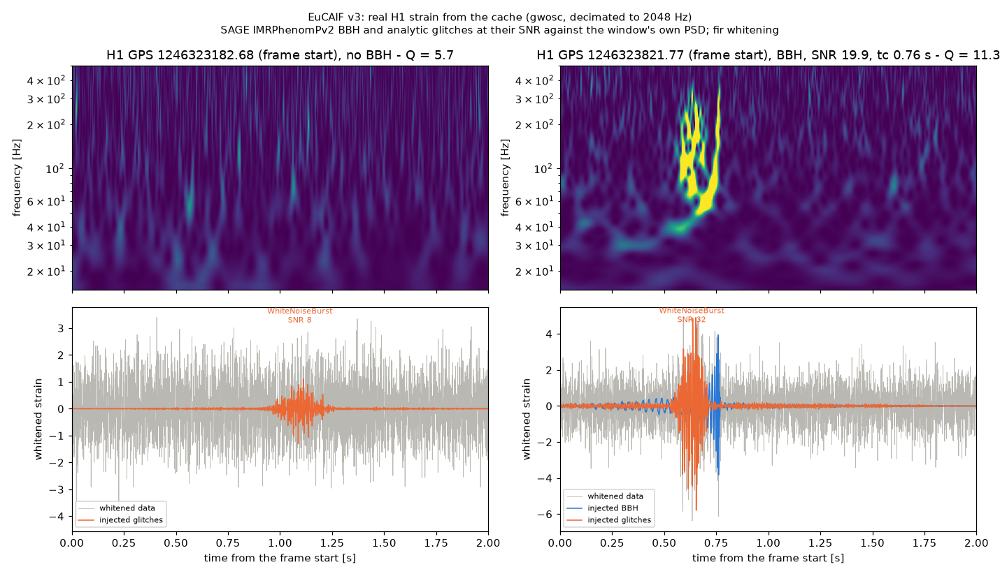
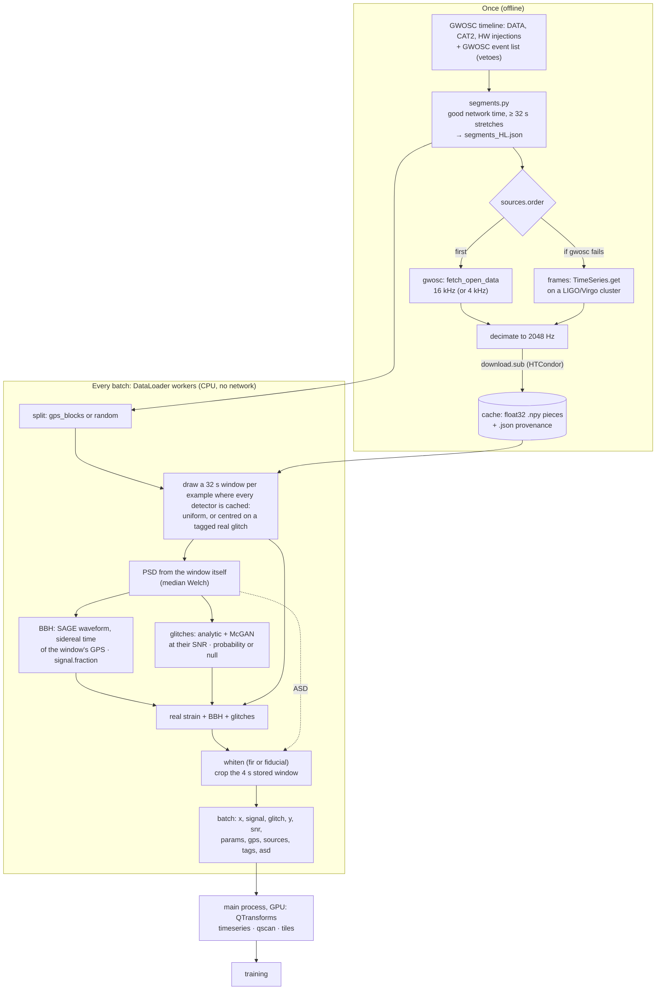
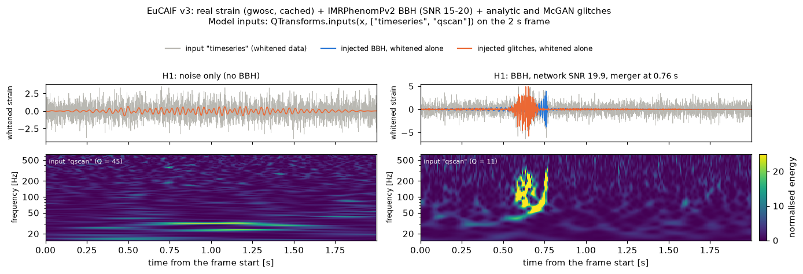

# EuCAIF dataset v3: real detector noise with BBH and glitch injections

v3 replaces v2's Gaussian noise with **real H1/L1 strain** (O3a, O3b, O4a). Each example still has an optional
binary black hole and optional analytic glitches. The strain is downloaded once into a local cache. Training then
reads it on the fly, never touching the network. Every example keeps the GPS time and source of its data.
Everything is set in `eucaif/eucaif_v3.yaml`.

Run from the SAGE repo root with `PYTHONPATH=.` in the `eucaif/environment.yml` environment (gwpy ≥ 4).
Version: v3.0 (tag `eucaif-dataset-v3.0`).



A noise-only and a BBH example (network SNR 19.9) in real H1 O3a data: Q-scans of the 2 s frame (top) and the
whitened time series (bottom). Blue: the injected BBH; orange: the injected glitches. The background is real, so
it can also hold real glitches that are not labelled. Made by
`python eucaif/example_eucaif_v3.py --detectors H1 --out eucaif/figures/eucaif_v3_example.png` on a partial
H1 cache.

## What changes from v2

| | v2 | v3 |
|---|---|---|
| Noise | Gaussian, from analytic ASDs | real strain from GWOSC (or frames on a cluster) |
| PSD | the analytic ASD | each window's own: median Welch over its 32 s context |
| Sky projection | random sidereal time | the sidereal time of the window's GPS time (`ConstantProjection.set_gps`) |
| BBH share | 50 % | `signal.fraction` (default 0.5; 0 = noise only) |
| Whitening | FIR | pluggable: `fir` (gwpy's whiten) or `fiducial` (SAGE `main`'s), or your own |
| Splits | independent seeds | `gps_blocks` (disjoint GPS blocks) or `random` (anywhere) |
| Extra outputs | | `gps`, `sources`, the ASD, Gravity Spy `tags` |

The stored window (1 s + 2 s frame + 1 s), the BBH prior, `tc` and the glitch populations are v2.3's.

## Workflow



The top lane runs once: it finds the usable time from data-quality flags alone, then downloads and decimates the
strain into the cache. The bottom lane runs for every batch and reads only the cache.

## Steps

1. **Segments** (done for H1+L1: `eucaif/v3/segments_HL.json`). Good time comes from GWOSC's data-quality flags
   only, with no strain downloaded:

       python -m eucaif.v3.segments eucaif/eucaif_v3.yaml --out eucaif/v3/segments_HL.json

2. **Download** the strain into the cache, once, as a batch job:

       python -m eucaif.v3.sources download eucaif/eucaif_v3.yaml --dry-run    # how many files, how many GB
       mkdir -p logs/v3_download && condor_submit eucaif/v3/download.sub      # 100 HTCondor jobs

   Put `cache.directory` on shared disk first. Jobs skip what is already cached, so failed jobs can simply be
   resubmitted.

3. **Train** from the cache (next sections).

## How much data

Hours left after the vetoes, in stretches of at least 32 s (`segments.min_length`):

| Network | O3a | O3b | O4a | Total |
|---|---|---|---|---|
| H1 | 3,104 | 2,767 | 3,853 | 9,724 |
| L1 | 3,313 | 2,705 | 3,940 | 9,958 |
| V1 | 3,343 | 2,664 | — | 6,007 |
| **H1 + L1** (default) | 2,548 | 2,297 | 3,052 | **7,898** |
| H1 + V1 | 2,350 | 2,108 | — | 4,458 |
| L1 + V1 | 2,540 | 2,077 | — | 4,617 |
| H1 + L1 + V1 | 1,927 | 1,750 | — | 3,677 |

The vetoes:

- **Data quality:** GWOSC `DATA` minus CBC Category 2 and hardware injections, as SAGE `main`'s `data_quality.py`.
- **Known events:** every event in GWOSC's event list (456, marginal ones included) is removed from 30 s before
  to 10 s after.

V1 has no O4a data on GWOSC.

H1 + L1 needs 16,650 GWOSC files (4096 s each, up to ~0.5 GB at 16 kHz). The cache keeps them decimated to
2048 Hz float32: **466 GB**.

## Where the strain comes from

`sources.order` lists the sources to try; the next one is used if one fails (e.g. GWOSC is down).

| | `gwosc` (default) | `frames` |
|---|---|---|
| Access | open: `TimeSeries.fetch_open_data` | LIGO/Virgo cluster: `TimeSeries.get(channel, frametype=...)` |
| Rate | 16384 Hz (default) or 4096 Hz | 16384 Hz |
| Decimation to 2048 Hz | 16 kHz: SAGE `decimate` ×8. 4 kHz: GWOSC's own filter, then ×2 | SAGE `decimate` ×8 |
| Calibration | GWOSC's offline release | whatever channel and frame type you set |

The two sources cannot give identical data: the calibration versions differ, and 4 kHz files are filtered by
GWOSC. With 16 kHz on both sides the processing in SAGE is the same. Every cached piece records its source,
channel and frame type, and every batch returns them (`sources`). The channels and frame types in the YAML are
examples only: set the ones you want on your cluster.

## Splits

- `gps_blocks` (default): the time is cut into 4096 s GPS blocks, assigned 80/10/10 to
  train/validation/test (seeded). The splits share no data and no PSD context.
- `random`: every split draws anywhere, as ggwd FM production does. Splits may overlap, so use different seeds.

## Whitening

`whitening.method`:

- `fir` (default): `FIRWhitening`, which matches gwpy's `TimeSeries.whiten`, with each window's ASD. It uses a
  4 s filter, a 15 Hz high-pass and float64 arithmetic.
- `fiducial`: SAGE `main`'s `FiducialWhitening`, a frequency-domain division by a fixed ASD per detector. It
  reads `main`'s fiducial files or an `.npz`.

To add a method, subclass `Whitener` in `eucaif/v3/whitening.py`, set `name`, implement `from_config` and
`whiten`, and decorate it with `@register`. Its name can then be used in the YAML.

## Signals and glitches

- **BBH:** SAGE waveforms, `IMRPhenomPv2` by default. SAGE also has IMRPhenomD, XAS, XHM, XP and XPHM
  (`signal.approximant`; the prior must provide their parameters). Physical distances, or a network SNR drawn
  from `snr_range` against the window's PSD.
- **Glitches:** v2.3's analytic shapes (strain) with Gravity Spy O3a rates, plus v2's non-physical (McGAN)
  shapes. `glitches.probability: 0` turns the physical ones off; `glitches: null` turns all of them off. V1 has
  no rates yet, so a network with V1 stops with an error.
- **Real glitches** in the background are not removed. If `glitch_tags` points to Gravity Spy tables (Zenodo
  5649212, H1/L1), each window lists the labelled glitches it holds. A detector without a table gives `None`
  (unknown).
- **Observed real glitches:** with `observed_glitches.fraction > 0`, that share of examples is centred on a
  tagged real glitch instead of a uniform time. The glitch lands at `time_in_frame` in the 2 s frame, filtered
  by confidence and label, optionally one label as often as another. Their label (`observed`) is Gravity Spy's,
  and there is no `glitch` target: the real glitch is part of the noise. Analytic glitches are not added to them
  unless `inject_glitches: true`; a BBH is added as for any example (`y`). Set `psd.exclude_centre: true` with
  this, so the glitch does not bias its own PSD.

## Recipes and matched pairs

Every example can be regenerated exactly, and compared with itself without a component.

- **Recipes.** Batch randomness is fixed by (seed, batch key); the loader uses (epoch, batch index). Each example
  has a `recipe` (config hash, seed, key, its position, the batch's window GPS times), and
  `EucaifV3.replay(recipe)` rebuilds it bit for bit. Windows are taken by GPS, so a cache that has grown since
  doesn't matter.
- **Matched pairs.** `without(b, "glitch")` is the same example without its injected glitches, and
  `without(b, "signal")` without its BBH: same noise, same PSD, same everything else. It is exact because the PSD
  comes from the strain before any injection, and the whitening is linear. A test checks it against regenerating
  with glitches or BBHs switched off.

```python
from eucaif.v3.generator import EucaifV3, load_config, without

gen = EucaifV3(load_config("eucaif/eucaif_v3.yaml"), split="test", seed=0)
b = gen.batch(64, key=(0, 0))
clean = without(b, "glitch")              # pairs: model(b["x"]) vs model(clean) isolates the glitches' effect
again = gen.replay(b["recipes"][17])      # example 17, regenerated
```

## Training on the fly

The DataLoader workers are CPU processes: they read the cache, inject and whiten, in parallel with training.
Model inputs (Q-transforms) are computed afterwards, in the main process, on the GPU, as in v2. CUDA should not
be used inside workers: forked processes cannot initialise it, and spawned ones each take their own GPU context
and memory.

```python
from eucaif.eucaif_v2 import QTransforms
from eucaif.v3.dataset import make_loader

loader = make_loader("eucaif/eucaif_v3.yaml", split="train", batch_size=64, num_workers=4, pin_memory=True,
                     overrides={"signal": {"fraction": 0.5}})     # e.g. {"signal": {"fraction": 0}, "glitches": None}
qt = QTransforms(loader.dataset.cfg, device="cuda")              # the YAML's qtransform settings, on the GPU
for epoch in range(10):
    loader.dataset.set_epoch(epoch)
    for b in loader:
        x = b["x"].cuda(non_blocking=True)                        # (B, D, 8192) whitened stored window
        inp = qt.inputs(x, ["timeseries", "qscan"])               # any of timeseries, qscan, tiles
        ...
```

| Input | Shape | What |
|---|---|---|
| `timeseries` (`qt.frame(x)`) | (B, D, 4096) | whitened time series of the 2 s frame |
| `qscan` (`qt.qscan(x)`) | (B, D, 256, 256) | gwpy-exact Q-scan image of the frame (time × frequency) |
| `tiles` (`qt.tiles(x)`) | {5.7: (B, D, 22, 8192), 45.3: (B, D, 183, 1024)} complex | invertible Q-tiles, one entry per Q |



The `timeseries` and `qscan` inputs of a noise-only and a BBH example (network SNR 19.9) in real H1 O3a data,
with the injected BBH (blue) and glitches (orange) whitened alone. The noise-only example also holds an injected
low-frequency glitch (the band near 30 Hz). Made from a partial H1 cache by
`python eucaif/example_model_inputs.py v3 --seed 4 --detectors H1 --out eucaif/figures/eucaif_v3_model_inputs.png`.

- **No network access:** the loader reads only the cache.
- **Partial downloads work:** windows are drawn only where the cache has data for every detector; the log says
  how many hours that is.
- **Reproducible:** batch *i* of epoch *e* is fixed by (seed, *e*, *i*), whatever the number of workers, and
  every example can be regenerated from its recipe (see "Recipes and matched pairs").

A batch (B examples, D detectors, L = 8192 samples = 4 s at 2048 Hz):

| Key | Shape | What |
|---|---|---|
| `x` | (B, D, L) float32 | whitened data + injections, the stored window (model inputs: above) |
| `signal`, `glitch` | (B, D, L) float32 | the injected BBH and glitches, whitened alone (targets) |
| `y` | (B,) | 1 if a BBH was injected |
| `snr`, `snr_det` | (B,), (B, D) | network and per-detector optimal SNR of the BBH (NaN without one) |
| `tc` | (B,) | BBH merger time from the start of the stored window (s) |
| `params` | dict of (B,) | BBH parameters |
| `gps` | (B,) float64 | GPS time of the stored window's first sample |
| `sources` | B × D | which source each detector's data came from |
| `fplus`, `fcross`, `delay` | (B, D) | the BBH's antenna factors and arrival delay from the geocentre (s), at the window's GPS time (NaN without one) |
| `glitch_events` | B lists | injected glitches: class, SNR, `snr_in_frame` and `frame_fraction` (SNR inside the 2 s frame and the share of SNR² there), detector, time, GPS |
| `tags` | B × D | labelled real glitches in the window (`None`: no table) |
| `observed` | B | the tagged real glitch an example is centred on (detector, GPS, label, confidence, time), else `None` |
| `recipes` | B | what `EucaifV3.replay` needs to regenerate each example |
| `asd_frequencies`, `asd` | (F,), (B, D, F) | the ASD used for whitening and SNRs |

The 2 s frame is `x[..., 2048:6144]`. The extra 1 s on each side is for Q-transforms.

## Not done yet

- **Speed:** the time per batch on a full cache has not been measured.
- **Fixed sets:** there is no HDF5 writer for fixed validation/test sets yet.
- **V1:** glitch rates are still missing.

## Files

| File | What |
|---|---|
| `eucaif/eucaif_v3.yaml` | the config |
| `v3/segments.py` | good time, event vetoes, splits, window sampling, Gravity Spy tags |
| `v3/sources.py` | GWOSC / frames, decimation, the cache, the `download` command |
| `v3/download.sub` | HTCondor job for the download |
| `v3/whitening.py` | `Whitener` plug-ins (`fir`, `fiducial`) |
| `v3/generator.py` | `EucaifV3`: one batch from the cache |
| `v3/dataset.py` | `make_loader` / `EucaifV3Stream`: on-the-fly training |
| `example_eucaif_v3.py` | the figure above |
